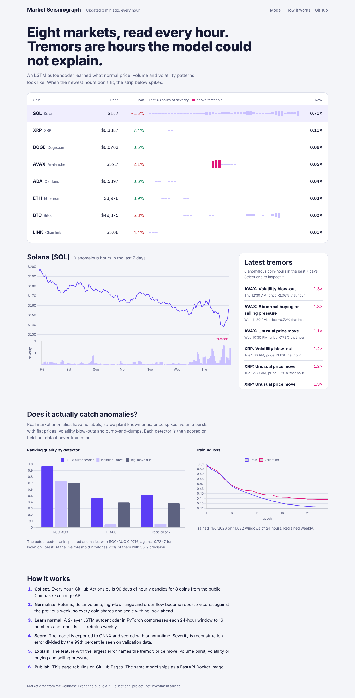
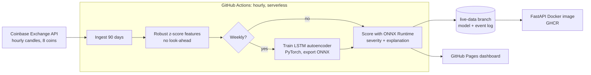

# Market Seismograph: real-time crypto anomaly detection

[](https://github.com/PalakGupta7456/crypto-anomaly-detector/actions/workflows/ci.yml)
[](https://github.com/PalakGupta7456/crypto-anomaly-detector/actions/workflows/pipeline.yml)


**Live dashboard: https://palakgupta7456.github.io/crypto-anomaly-detector/**

A deep-learning system that watches 8 crypto markets (BTC, ETH, SOL, XRP, ADA, DOGE, AVAX, LINK) every hour and flags hours whose price, volume and volatility behaviour it has not seen before. It runs serverless on GitHub Actions, trains with PyTorch, and serves with ONNX Runtime.



## Results

<!-- RESULTS -->

**How it is evaluated.** Real market anomalies have no labels, so the project follows the standard *synthetic injection* protocol used in anomaly-detection research. Four kinds of known shocks are planted into the held-out test period (the last 15% of time, never seen in training):
- price spikes
- volume bursts while the price stays flat (a wash-trading pattern)
- volatility blow-outs
- pump-and-dump shapes

Each detector is then scored on how well it ranks the planted hours above normal ones.

## Architecture



## How it works

**Features** (`src/cad/features.py`). Five signals are computed each hour:
- log return and absolute return
- log dollar volume
- high-low range
- signed volume-weighted flow

Each becomes a **robust z-score** (median and MAD) against the *previous* week. This makes a $60,000 coin and a $0.10 coin comparable, so one model can learn from all 8 markets. A unit test proves that changing a future price never changes a past feature.

**Model** (`src/cad/model.py`). A sequence-to-sequence **LSTM autoencoder**:
- a 2-layer LSTM encoder squeezes each 24-hour window into a 16-dimensional bottleneck
- a 2-layer LSTM decoder rebuilds the window
- it is trained with Smooth-L1 loss, AdamW, cosine learning-rate decay, gradient clipping, and early stopping on validation loss

Because it only ever learns to rebuild normal behaviour, unusual hours come back with large errors.

**Scoring** (`src/cad/scoring.py`). The anomaly score is the mean of the 3 largest reconstruction errors in the most recent 3 hours. Averaging over the whole window would dilute a shock that hits only one signal. **Severity** is the score divided by the 99th percentile of out-of-sample (validation) scores, so `severity > 1` means "flag". The feature with the largest error names the anomaly: price move, volume burst, volatility, or buying and selling pressure.

**Serving.** The trained network is exported to **ONNX**. The hourly pipeline and the API only need `onnxruntime`, so they never install PyTorch. The serving Docker image is about 8× smaller, and inference runs on CPU in milliseconds.

## MLOps and CI/CD

| | |
|---|---|
| `ci.yml` | ruff lint, trains on synthetic data, exports ONNX, pytest, builds the Docker image, smoke-tests `/health` with the model loaded, pushes to `ghcr.io` |
| `pipeline.yml` | hourly cron: ingest, retrain (weekly), score, event log, GitHub Pages deploy. State lives on the `live-data` branch |
| `Jenkinsfile` | the same CI flow for Jenkins |
| `Dockerfile` | slim non-root image with onnxruntime and FastAPI, plus a health check |

## API

```bash
docker run -p 8000:8000 ghcr.io/palakgupta7456/crypto-anomaly-detector
curl localhost:8000/score/BTC?hours=24     # severity and flag for each hour, with the reason
curl localhost:8000/model                  # threshold and benchmark
```

## Run locally

```bash
pip install torch --index-url https://download.pytorch.org/whl/cpu
pip install -e ".[train,api,dev]" onnxscript
python -m cad.ingest      # live candles (or: python -m cad.synthetic)
python -m cad.train       # train, benchmark, export ONNX
python -m cad.detect      # writes docs/data/latest.json
python -m http.server -d docs 8080
pytest
```

## Limitations

- Planted anomalies are a proxy. Real events can be subtler, or can be legitimate news-driven moves.
- The threshold is a fixed quantile. A cost-sensitive threshold, or one tuned per coin, would be a natural next step, as would adding order-book depth features.

*Educational project; not investment advice.*
